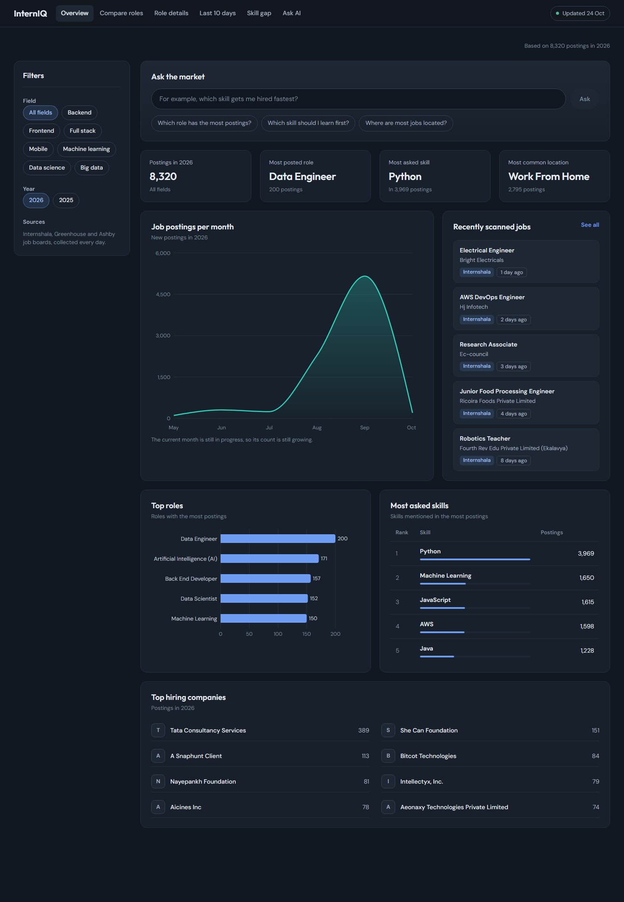
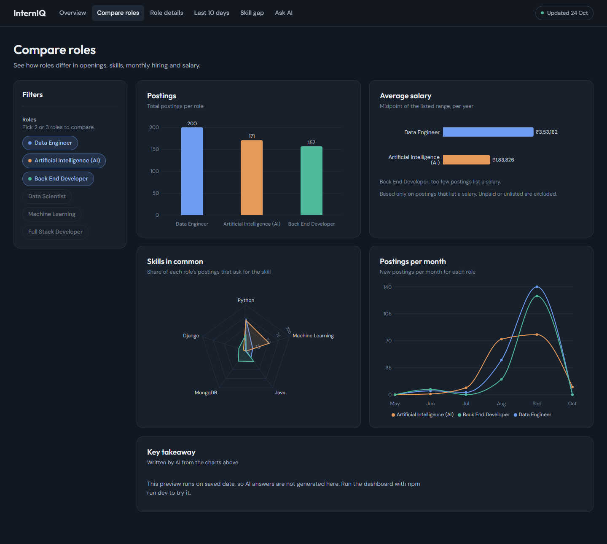
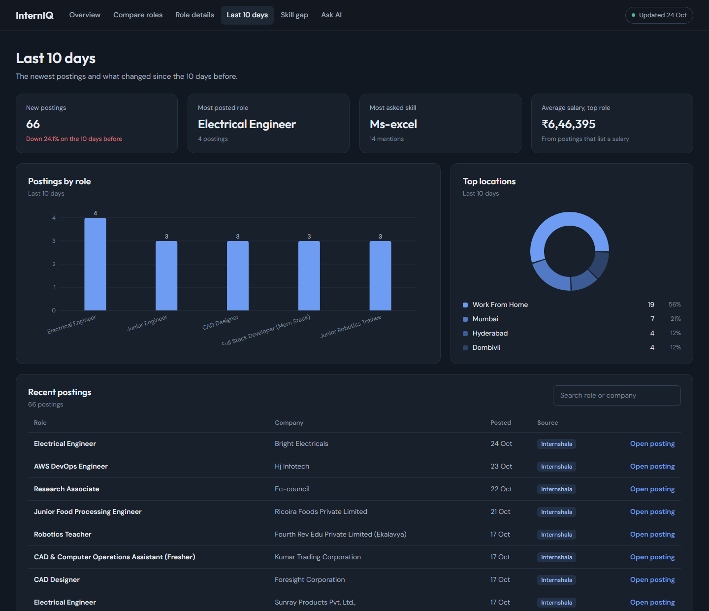
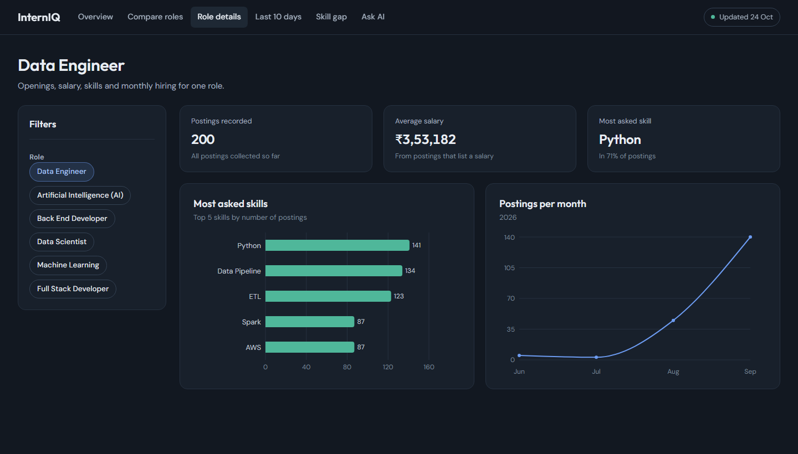
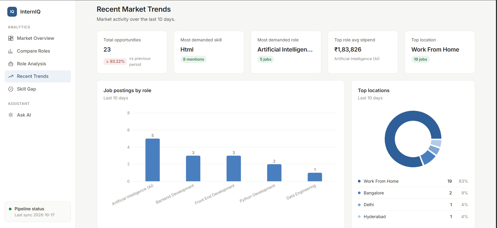
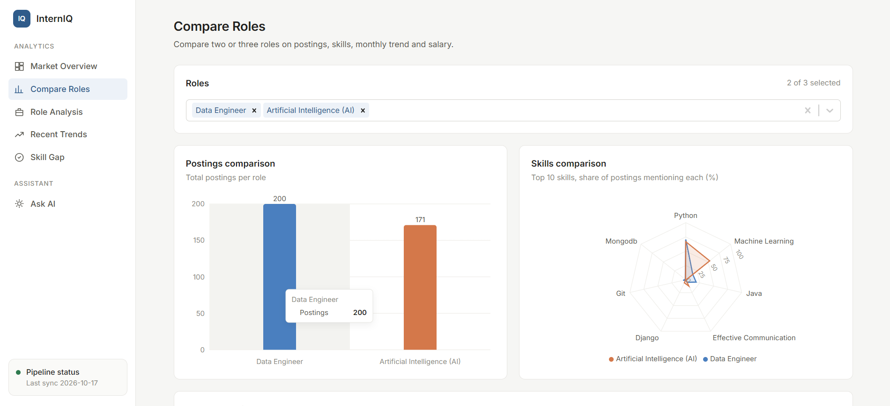
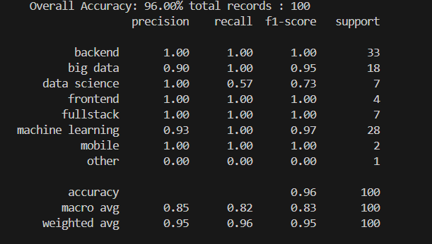
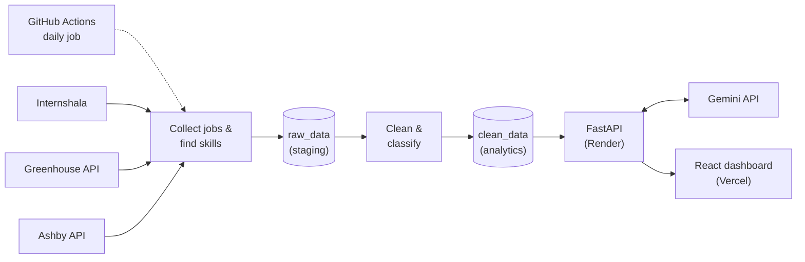
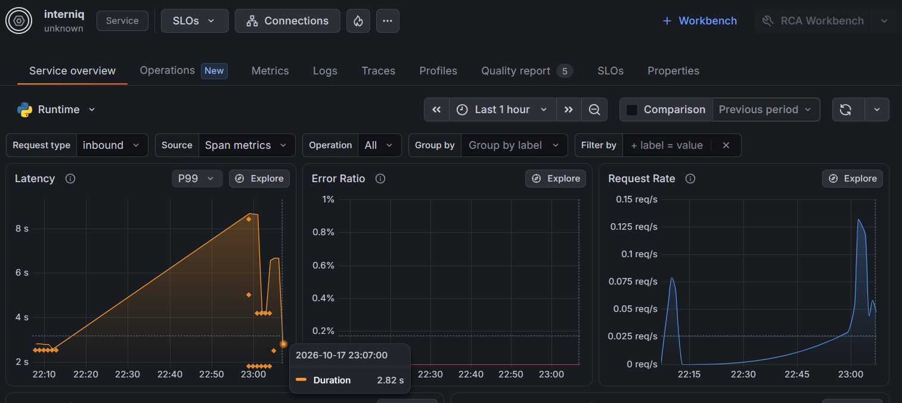

# InternIQ

**Job market intelligence for tech jobs in India.**

InternIQ shows what the tech job market in India looks like right now: which roles are hiring, which skills employers ask for, what jobs pay and where the jobs are.

Every day, a data pipeline collects new tech job postings from three sources: **Internshala**, and the public job boards of companies that hire through **Greenhouse** and **Ashby**. The pipeline cleans the data, finds the skills in each posting, sorts each job into a field such as Backend or Data Science, and stores everything in PostgreSQL. A FastAPI backend turns this data into numbers and charts, and a React dashboard shows them. Google Gemini adds short AI summaries and answers questions in plain English.

It is built as a complete data engineering project: scheduled collection, a staging layer, a cleaning step, a role classifier, database migrations, an API, a dashboard, tests, CI and monitoring.

---

## Live Demo

| What | Link |
|------|------|
| Dashboard (Vercel) | [intern-iq-five.vercel.app](https://intern-iq-five.vercel.app/) |
| API (Render) | [interniq-t9hh.onrender.com](https://interniq-t9hh.onrender.com) |
| API health check | [`/api/health`](https://interniq-t9hh.onrender.com/api/health) |

> **Note:** The API runs on Render's free plan and sleeps when nobody uses it. Open the [health check](https://interniq-t9hh.onrender.com/api/health) first, wait a few seconds for it to wake up, then open the dashboard.

---

## Screenshots



<table>
  <tr>
    <td width="50%"></td>
    <td width="50%"></td>
  </tr>
  <tr>
    <td align="center"><b>Compare roles:</b> openings, salary, shared skills and monthly hiring for 2 or 3 roles</td>
    <td align="center"><b>Last 10 days:</b> the newest postings by role and location, with a searchable list</td>
  </tr>
</table>



<details>
<summary>Earlier design</summary>

<table>
  <tr>
    <td width="50%"></td>
    <td width="50%"></td>
  </tr>
  <tr>
    <td align="center">Recent Market Trends (earlier design)</td>
    <td align="center">Compare Roles (earlier design)</td>
  </tr>
</table>

</details>

---

## What It Answers

1. Which tech roles have the most openings right now?
2. Which skills does each role ask for, and how do roles compare?
3. What do jobs really pay, once every salary is turned into rupees per year?
4. Which skills are missing from my resume for the role I want?

---

## Data Sources

| Source | How it is collected | What it adds |
|--------|---------------------|--------------|
| **Internshala** | Scrapes 10 tech job categories, page by page | Internships and fresher jobs from Indian companies |
| **Greenhouse** | Public job board API, no key needed | Jobs from Databricks, Okta, MongoDB, GitLab, Stripe, Razorpay and 6 more companies |
| **Ashby** | Public job board API, no key needed | Jobs from Sarvam AI, OpenAI, Cursor, Atlan, Composio and Notion |

For Greenhouse and Ashby, InternIQ keeps only **tech jobs in India**:

- A job counts as tech when its title has words like engineer, developer, data, ML or DevOps, and no words like sales, marketing or recruiter.
- A job counts as India when its location is an Indian city or "India".
- Skills come from the job description, using the same skill matcher as Internshala.
- Ashby salaries are converted to the same format as Internshala salaries. Greenhouse does not publish salaries.

Every job is saved with a `source` column (`internshala`, `greenhouse` or `ashby`), so you can always tell where it came from.

All boards are requested at the same time with `httpx`, so collecting about 300 jobs from 18 companies takes around 10 seconds. To add a company, put its board name in `GREENHOUSE_BOARDS` or `ASHBY_BOARDS` in `extract/fetcher.py`.

---

## How It Works

1. **Collect:** A GitHub Actions job runs every day. It scrapes Internshala and calls the Greenhouse and Ashby APIs. When an Internshala posting has no skill tags, the skills are found in its description.
2. **Stage:** All jobs from one run are saved together in the `raw_data` schema.
3. **Clean:** Salaries are read, converted to rupees and turned into a yearly amount. Dates are read and duplicates are removed.
4. **Classify:** Each job is given a main field (for example Backend or Data Science) and a confidence score.
5. **Store:** The clean jobs are saved in the `clean_data` schema, with one snapshot row per job per day for trends.
6. **Serve:** FastAPI answers the dashboard's requests, adds AI summaries and checks uploaded resumes.

---

## Key Features

- **Three job sources:** Internshala, Greenhouse and Ashby, collected every day and stored in the same tables.
- **Role classifier:** Matches job titles and skills to keyword lists first. Unclear titles are compared with reference descriptions of seven fields using TF-IDF.
- **Salary cleaner:** Understands rupees, dollars, euros and dirhams, converts them to rupees, and turns monthly pay into yearly pay. Jobs without a salary are left out of averages instead of counted as zero.
- **AI summaries and chat:** Gemini writes short summaries of the charts and answers questions such as "Which skill should I learn first?" using the dashboard's own data.
- **Compare roles:** Put 2 or 3 roles side by side: openings, average salary, shared skills and monthly hiring.
- **Resume skill gap:** Upload a PDF or DOCX resume, pick a field, and see which skills you have and which are missing, ranked by how often employers ask for them.
- **Last 10 days view:** The newest postings and how they compare with the 10 days before.
- **Database migrations:** Schema changes are tracked with Alembic, so every change can be applied and undone safely.

### Role Classifier Accuracy

On a test set of 100 randomly chosen postings, the classifier picks the right field **96% of the time**:



---

## Tech Stack

| Part | Tools |
|------|-------|
| Data collection | Requests, BeautifulSoup4 (Internshala), httpx (Greenhouse and Ashby APIs) |
| Classification | Keyword rules, scikit-learn TF-IDF, cosine similarity |
| Database | PostgreSQL (Aiven), SQLAlchemy, psycopg2, Alembic |
| Backend | FastAPI, Uvicorn, Pydantic |
| AI | Google Gemini, `async_lru` for caching |
| Resume reading | PyMuPDF (PDF), python-docx (DOCX) |
| Frontend | React 19, Vite, TanStack Query, Recharts |
| Monitoring | OpenTelemetry, Grafana Cloud |
| CI/CD | GitHub Actions (tests on every push and PR, daily data collection) |
| Hosting | Vercel (frontend), Render (backend), Aiven (database) |

---

## Architecture



**Why it is built this way**

- **Two schemas (`raw_data` and `clean_data`):** Collected data is messy. Keeping it in a separate staging schema means a bad scrape or a failed cleaning step never breaks the tables the dashboard reads.
- **One insert per run:** Jobs from all three sources are saved in one batch with one run ID, so the cleaning step always processes the whole run.
- **`job_snapshot` table:** Stores one row per job per day, so a job seen on several days is not counted twice. The pipeline fills it already; trend queries will move to it later.
- **Three separate services:** The pipeline runs on a schedule, the API is always on, and the frontend is static. A slow scrape never slows down the dashboard.

---

## Monitoring

The API sends traces and metrics to Grafana Cloud using OpenTelemetry. There is no monitoring code inside the app: `opentelemetry-instrument` wraps FastAPI, SQLAlchemy and the calls to Gemini when the server starts.



For every endpoint, the dashboard tracks:

- **Latency (p50, p95, p99):** how long requests take, so slow endpoints stand out.
- **Error ratio:** the share of requests that fail.
- **Request rate:** how much traffic the API gets.

Each request also has a trace that splits its time into database queries, Gemini calls and Python code. These traces showed that the API (Render, US East) and the database (Aiven, Bangalore) were on different continents, which slowed down every query. Moving the API to Singapore cut the p95 latency of `/api/last-sync` from about 5.1 s to about 2.4 s.

---

## Database

One PostgreSQL database on Aiven, with two schemas.

**`raw_data` (staging)**

| Table | What it holds |
|-------|---------------|
| `job_data` | Jobs as collected: title, company, location, salary text, dates, link, `source` and `run_id` |
| `skills`, `job_skills` | Skill names and which job has which skill |
| `job_snapshot` | One row per job per collection day |

**`clean_data` (analytics)**

| Table | What it holds |
|-------|---------------|
| `job_data` | Clean titles, dates, `salary_min` and `salary_max` in rupees per year, `primary_field`, `field_confidence` and `source` |
| `skills`, `job_skills` | Clean skill names and which job has which skill |
| `locations`, `job_location` | Locations and which job is in which location |
| `job_snapshot` | One row per job per collection day, for future trend queries |

**Migrations**

Schema changes live in `migrations/versions/` and are applied with Alembic. Alembic reads the same `DB_*` values from `.env` as the app.

```bash
alembic upgrade head      # apply all migrations
alembic current           # show the current version
alembic downgrade -1      # undo the last migration
```

---

## API

Built with FastAPI. Requests are checked with Pydantic models.

| Endpoint | Method | What it returns |
|----------|--------|-----------------|
| `/api/health` | GET | Health check |
| `/api/last-sync` | GET | Date of the last data collection |
| `/api/job-tiles` | GET | Total postings, top role, top skill and top location for a field |
| `/api/top-role-table` | GET | Roles ranked by number of postings |
| `/api/top-skills` | GET | Skills ranked by number of postings |
| `/api/job-postings` | POST | Postings per month for a year and field |
| `/api/top-companies` | POST | Companies with the most postings |
| `/api/job-posting-card-insights` | POST | AI summary of the overview charts |
| `/api/role-details` | GET | Postings, average salary, top skills and monthly postings for one role |
| `/api/get-role-posting` | POST | Postings and average salary for selected roles |
| `/api/common-skill` | POST | How often each selected role asks for each shared skill |
| `/api/get-linechart-data` | POST | Postings per month for selected roles |
| `/api/get-comparative-insights` | POST | AI takeaway comparing the selected roles |
| `/api/recent-market-trend` | GET | Last 10 days: postings, change, top role, skill, location and salary |
| `/api/job-posting-list` | GET | Recent individual postings |
| `/api/get-top-locations` | GET | Top locations in the last 10 days |
| `/api/analyze-gap` | POST | Upload a resume (PDF or DOCX) to get matched and missing skills |
| `/api/chatwith_ai` | POST | Answer to a question about the job market |

---

## Dashboard

A dark dashboard with a top navigation bar. Most pages have a filter sidebar.

| Page | What it shows |
|------|---------------|
| **Overview** | An "Ask the market" box, summary stats, postings per month, recently scanned jobs, top roles, top skills and top hiring companies, filtered by field and year |
| **Compare roles** | 2 or 3 roles side by side: postings, average salary, shared skills (radar chart), monthly postings and an AI takeaway |
| **Role details** | One role's postings, average salary, most asked skills and postings per month |
| **Last 10 days** | New postings and their change, postings by role, top locations and a searchable list of the newest jobs |
| **Skill gap** | Upload a resume, pick a field, and see matched and missing skills ranked by demand |
| **Ask AI** | A chat that answers questions about roles, skills, salaries and locations using InternIQ data |

Salaries are shown in full rupees per year and are based only on postings that list a salary. Data loading and caching use TanStack Query, and the charts use Recharts.

---

## Project Structure

```
extract/            fetcher.py: Internshala pages and the Greenhouse and Ashby APIs
                    extractor.py: reads job cards from Internshala pages
transform/          transform_data.py: salary, currency and date cleaning
keyword_match/      dev_trend.py (role classifier), text_tokenization.py (skill matching)
insert_raw_data/    insert_raw_data.py: saves jobs to raw_data
insert_clean_data/  insert_clean_data.py: saves clean jobs to clean_data
dbconnection/       dbconnect.py: database connections for each schema
migrations/         Alembic migrations (alembic.ini in the project root)
queries/            SQL queries used by the API
backend/            FastAPI app: main.py, routes/, crud.py (AI and resume reading), models.py
frontend/           React and Vite dashboard: src/App.jsx, src/pages/, src/components.jsx
testing/            pytest tests
.github/workflows/  tests.yml (tests), scrape.yml (daily data collection)
mainscript.py       Pipeline entry point: collect, stage, clean and store
```

---

## Local Setup

**1. Clone the project**

```bash
git clone https://github.com/Jairamhegde/InternIQ.git
cd InternIQ
```

**2. Add your settings**

Create a `.env` file in the project root:

```env
DB_HOST=your-aiven-postgres-host
DB_PORT=your-aiven-postgres-port
DB_NAME=your-database-name
DB_USER=your-database-user
DB_PASSWORD=your-database-password
SSLMODE=require
GEMINI_API=your-gemini-api-key
```

**3. Install, set up the database and run the pipeline**

```bash
python -m venv venv
source venv/bin/activate        # Windows: venv\Scripts\activate
pip install -r requirements.txt
alembic upgrade head
python mainscript.py
```

**4. Start the API**

```bash
uvicorn backend.main:app --reload
```

**5. Start the dashboard**

```bash
cd frontend
npm install
npm run dev
```

The dashboard uses the live Render API by default. To use your local API instead, create `frontend/.env`:

```env
VITE_API_URL=http://localhost:8000
```

---

## Testing and CI

| Workflow | When it runs | What it does |
|----------|--------------|--------------|
| `tests.yml` | Every push and pull request to `main` | Runs the full pytest suite |
| `scrape.yml` | Every day | Collects jobs from all three sources and updates the database |

```bash
# Run the tests
python -m pytest testing/

# Run the classifier accuracy report
python -m testing.test_classifier_extractor
```

---

## Roadmap

- **More job boards:** add Lever and Workable, and merge the same job when it appears on more than one source.
- **Filter by source:** let the dashboard show one source at a time.
- **Use `job_snapshot` for trends:** move the trend queries to the daily snapshot table.
- **Faster API:** cache API responses in Redis and refresh them after each data collection.

---

## Known Limitations

- Currency conversion uses fixed exchange rates, not live rates.
- Greenhouse does not publish salaries, so salary averages come from Internshala and Ashby only.
- Tech jobs from Greenhouse and Ashby are picked by job title, so an unusual title can be missed.
- The Internshala scraper depends on the current page layout. If Internshala changes its pages, `extract/extractor.py` needs an update.
- Render's free plan sleeps when idle, so the first request can be slow.
- Tests run against the live Aiven database, not a separate test database.

---

## Author

**Jairam Hegde**: [GitHub](https://github.com/Jairamhegde)
